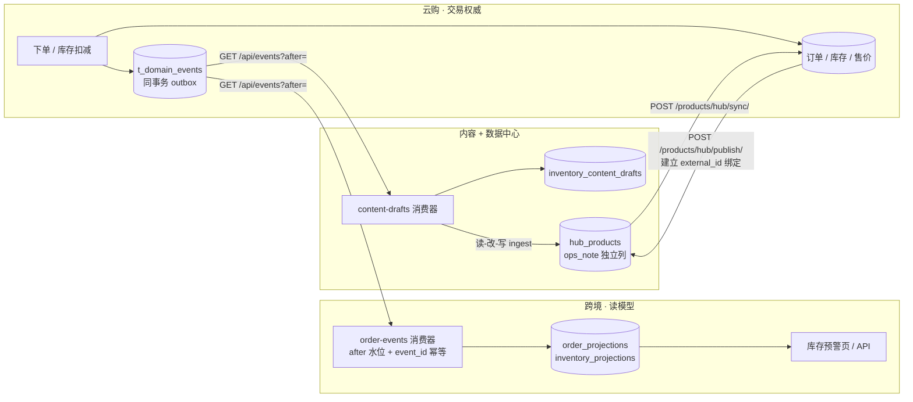

# 三系统合并体：架构与关键决策

> 本文面向第一次接触本项目的读者，回答三个问题：**系统边界在哪、业务事实怎么跨系统流动、关键取舍付了什么代价**。
> 只记录已落地并可由测试或验收脚本复现的内容。当前基线见 [统一交付/README.md](统一交付/README.md)；15 份历史过程报告与本地备份已于 2026-11-08 按用户要求彻底删除（报告已进 git，可从 `c0aec8b` 取回）。

---

## 一、系统边界

四个独立 git 仓库，没有 monorepo，没有共享数据库事务。

| 仓库 | 角色 | 主要技术 | 权威数据 |
|---|---|---|---|
| 云购多租户电商 SaaS 平台 | **唯一身份源**、交易与库存权威、商家后台宿主 | Flask + SQLAlchemy、Vue 3 (vue-cli) | 订单、库存、售价、租户与员工 |
| 跨境电商运营智能辅助系统 | 运营中台，消费云购事实 | FastAPI + Alembic、Vue 3 + Vite + TS | 本地投影读模型 |
| 电商智能内容生成与商品知识平台 | 内容生产、商品资料交换枢纽 data-hub | Express + React、stdlib HTTP、PostgreSQL | hub 商品资料与 `ops_note` |
| 电商垂类整合计划 | 编排、验收脚本与文档（元仓库，无产品代码） | Python / Node | 无 |

工作台 `统一电商工作台/start.py` 拉起 8 个服务、2 个后台消费进程与门户 `/status`：

| 端口 | 服务 |
|---|---|
| 5000 / 8080 | 云购 API / 宿主前端 |
| 8000 / 5175 | 跨境 API / 前端 |
| 3100 / 5174 / 8110 / 8120 | 内容 API / 前端 / 编排器 / data-hub |
| 8090 / 55432 | 工作台门户 / 内容 PostgreSQL |
| 无端口 | `order-events`、`content-drafts` 两个消费进程 |

**唯一身份链路**：云购登录签发会话 → 宿主 iframe 载入后经 `postMessage` 下发令牌（origin 白名单）→ 跨境与内容后端各自向云购 `/user/me/` 校验 → 登出由宿主广播清理三处存储。云购不可达时上游返回 503 而非 401，避免误登出。

---

## 二、业务事实流

三条链路（全部由 `verify.py` 端到端断言）：

1. **订单**：云购下单 → 同事务写 `order.created` → 跨境投影到 `order_projections` → 订单列表/详情/动作任务读投影表，不再依赖代码常量。
2. **库存**：库存扣减/回滚 → 同事务写 `stock.changed` → 跨境投影到 `inventory_projections` → `/api/v1/inventory/alerts` 与「库存预警」页。
3. **内容闭环**：同一批 `stock.changed` → 内容平台生成补货草稿 → 回推 hub 独立 `ops_note` → 云购同步后存入 `t_product_knowledge.knowledge_json` → `GET /products/ops-notes/` 仅在商家后台展示。

商品上行 `POST /products/hub/publish/` 是闭环的前提：自建商品原先在 hub 没有 `external_id`，事件无法映射到资料。上行同时写 `t_product_knowledge` 绑定，避免下一次同步按同名商品重复创建。

统一经营看板 `GET /api/unified/overview/` 由服务端聚合四路（本地库 + 8000 + 3100 + 8120），逐路超时 2.5s、失败标记 `unavailable` 且不回填演示数据。

---

## 三、架构决策记录（ADR）

每条按 **决策 / 备选 / 代价 / 证据 / 验证** 组织。备选方案不是"被否掉的错方案"，而是当时真实存在、且有明确取舍理由的路径。

### ADR-1 唯一身份源：云购会话

- **决策**：只有云购签发商家会话。跨境与内容后端实时向云购校验，不自建用户体系；宿主经 `postMessage` 把令牌下发给 iframe，来源限定在模块注册表的 origin 白名单；登录页按 `redirect` + `module_state` 回跳，登出广播清三处存储。
- **备选**：(a) 三套独立登录；(b) 共享 JWT 网关 / OAuth2 授权服务器；(c) 共享 Cookie 域。
- **代价**：内容平台每次请求多一次 HTTP 回源；上游故障时须严格区分 401 与 503，否则用户被误登出；iframe 方案依赖 `postMessage` 与第三方 Cookie 可用性，跨站部署需要重写为网关方案。(b)(c) 在架构上更干净，但需要独立认证服务或同域部署，超出当前范围。
- **证据**：`backend/app/services/merchant_session.py`、`backend/app/core/identity.py`、`apps/api-server/src/lib/merchant-identity.js`、`vue_shop/src/views/LoginView.vue`、`vue_shop/src/unified/modules.js`。
- **验证**：`统一电商工作台/verify.py` 的会话接口与故障语义断言；跨境 `tests/test_identity_e2e.py`。

### ADR-2 数据权威：库存与售价归商城，商品资料归 hub

- **决策**：hub 是商品资料的交换枢纽；商城自建商品的售价、库存由交易系统独占。hub 同步**只在新建商品时**用 hub 价格与库存初始化，已有商品重复同步只改资料字段，不覆盖交易定价与已扣减库存；同名但 `external_id` 不同的商品不自动关联。运营提示放独立 `ops_note` 列，不进 `desc_zh` / `selling_points`。
- **备选**：(a) hub 全量覆盖商城字段；(b) 双向同步最终一致；(c) 商城作为唯一写入方、hub 只读。
- **代价**：资料字段（`introduce`、`sell_points`、主图）仍会被 hub 覆盖，商城侧的人工编辑会被下一次同步冲掉；需要 `content_hash` + `version` 判定是否变更。(b) 曾造成「重复同步把已扣减的 5 件库存覆盖回 7 件」，是这条决策的直接来源。
- **证据**：`flask_shop/flask_shop/utils/hub_sync.py`、`apps/data-hub/app.py`。
- **验证**：`tests/test_hub_sync_price.py`、`tests/test_hub_sync_stock.py`、`tests/test_hub_sync_identity.py`、`apps/data-hub/test_ops_note.py`。

### ADR-3 跨系统事实流：outbox + 增量水位 + 幂等投影

- **决策**：云购订单与库存变动和业务写在**同一事务**写入 `t_domain_events`；`GET /api/events?after=` 以自增 id 作水位；下游各持水位表，以 `event_id` 唯一约束保证幂等；水位推进与投影写入同一事务。端点默认关闭，令牌缺一即拒绝（fail-closed）。
- **备选**：(a) 云购开只读订单 API、跨境实时拉取；(b) 引入 Kafka / RabbitMQ 事件总线；(c) 数据库 CDC。
- **代价**：至少一次投递，消费端必须幂等；轮询带来 10s 级延迟；没有跨库事务，顺序与回放依赖水位；单条失败会中断本轮并下轮重投。草稿回推 hub 失败只记 `hub_status=push_failed`，不自动重放，依赖下一笔库存事件。(a) 改动小但跨境可用性绑死云购；(b)(c) 更接近生产形态，但要引入并运维消息中间件，验证成本高于当前收益。
- **证据**：`flask_shop/flask_shop/models.py` (`DomainEvent`)、`flask_shop/events/views.py`、`backend/app/services/order_event_consumer.py`、`apps/api-server/src/services/inventory-draft-consumer.js`。
- **验证**：`tests/test_domain_events.py`、`backend/tests/test_order_event_consumer.py`、`verify_order_event_chain.py`。

### ADR-4 前端集成：iframe 折中 + 单一契约源 + 聚合视图

- **决策**：保留三套前端，宿主用 iframe 承载；模块注册表、origin 白名单、默认落点收敛到 `vue_shop/src/unified/modules.js` 一份；用服务端聚合的统一经营看板作为登录默认首屏，让「一个系统」在数据层可见。
- **备选**：(a) 技术栈统一为一个 SPA；(b) 微前端（qiankun / Module Federation）。
- **代价**：深链、返回栈、跨模块状态仍需宿主协议维护；三套 CSS 变量与 Element Plus 版本并存；「一个系统」靠导航与数据聚合呈现，**不是路由级集成**。
- **为什么不选 (a)**：实测宿主 `vue-router 4 / webpack 5 / JS`，跨境 `vue-router 5 / Vite 8 / TS 6 / Pinia + vue-query`，内容为 React；主版本冲突与跨框架挂载构成硬冲突，需重写路由与状态层、给宿主补 TS 工具链，涉及跨境 46 个源文件并推翻已验收运行态，而使用者感知不到差异。完整对照见 [统一交付/README.md](统一交付/README.md) 第十节。
- **证据**：`vue_shop/src/unified/modules.js`、`ModuleHostView.vue`、`UnifiedDashboardView.vue`、`flask_shop/unified/views.py`。
- **验证**：`verify.py` 的模块深链、统一看板四路聚合断言。

### ADR-5 运营元数据分层：`ops_note` 独立列

- **决策**：补货草稿等运营侧提示写 hub 的独立列 `ops_note`，商城同步后存进 `t_product_knowledge.knowledge_json`，只通过 `GET /products/ops-notes/` 在后台展示。C 端商品介绍与卖点保持干净。
- **备选**：(a) 拼进 `desc_zh` 尾部（早期实现，已废弃）；(b) 新增独立的 ops-note 写端点，不走 ingest 整条覆盖。
- **代价**：`ops_note` 计入 `content_hash`，运营侧改动会推进 `version` 并触发一次同步，尽管 C 端文案不变；ingest 是整条覆盖语义，**任何新增写入方都必须先读后写并带回 `ops_note`**，否则会清空提示。(b) 语义更纯，但需额外处理并发、版本与 `preserve_generated_copy`，当前把风险封在两个调用方（商品上行、草稿回推）更可控。
- **证据**：`apps/data-hub/app.py` (`migrate_schema` / `upsert_item`)、`flask_shop/utils/hub_publish.py`、`apps/api-server/src/services/inventory-draft-consumer.js`。
- **验证**：`apps/data-hub/test_ops_note.py`、`tests/test_hub_publish.py`、`verify_order_event_chain.py` 断言 `introduce` 不含运营提示。

---

## 四、怎么跑、怎么验

| 目的 | 命令 |
|---|---|
| 启动全部服务 | `py -3 统一电商工作台/start.py`（`UNIFIED_NO_BROWSER=1` 可禁自动开浏览器） |
| 全量测试 | `py -3 verify_all.py` |
| 全量测试 + 前端构建 + 运行时验收 | `py -3 verify_all.py --build --runtime`（构建会自动追加回收站兜底清理） |
| 仅交付物自检（CI 用） | `py -3 verify_all.py --self-check` |
| 单独清空回收站 | `py -3 verify_all.py --purge-recycle-bin`（仅 Windows 生效，清理后断言三盘归零） |
| 运行时契约与三段联动 | `py -3 统一电商工作台/verify.py`（需工作台已启动） |
| 单笔闭环复现 | `py -3 verify_order_event_chain.py` |

登录凭据（仅本机演示）：`demo` / `admin` / `123456`。主入口 `http://127.0.0.1:8080/admin/unified`。

`verify_all.py` 的单测口径与三个产品仓库的 CI 对齐：云购在 `TENANT_STRICT=1` 严格租户模式下跑（本地默认模式曾漏检回归），data-hub 跑 `apps/data-hub` 下全部测试文件。lint / typecheck / 前端构建仍由各仓库 CI 与 `--build` 档分别负责。

---

## 五、明确限制

1. **不能称为已上线**。公网与 HTTPS、真实支付商户号、短信服务、真实店主连续试用均未完成，且需要外部资质；`云购/TODO.md` P0 原文写明「不能伪造为已上线」。本项目的可验证范围是**内网演示与工程可信度**。
2. **三个模块仍是三套独立前端由 iframe 承载**，源码层没有合并；看板是聚合视图，不是路由级集成。
3. **草稿是只读展示，不是第二个数据源**。内容平台「商品批量内容」工作区展示库存联动补货草稿（含 `event_id`、库存、回推状态），但页面不提供手工写入口——草稿必须由 `stock.changed` 事件生成。内容平台仍不承载客服知识编辑或商品上架动作。
4. **四个独立 git 仓库**，2026-11-09～10 已全部推送到 GitHub：三个产品仓库各自跑 `CI`，元仓库 `awei-bug/ecommerce-unified-workbench` 跑 `delivery-self-check`，四条 workflow 均已通过。完整跨仓库测试仍只能在本地由 `verify_all.py` 跑；把联动验收搬进 CI 的前置条件是 monorepo 或多仓库 checkout + 凭据 + 服务容器。

   元仓库创建说明：环境变量 `GITHUB_TOKEN` 实测无效（401）、本机无 `gh` CLI，最终使用 **Git Credential Manager 缓存的本机凭据**调用 `POST /user/repos` 建仓，再以 HTTPS remote 推送。该凭据仅在本机使用，未写入仓库任何文件；推送前已核查 46 个已跟踪文件不含密钥、数据库或备份。
5. 所有「功能全部跑通」类表述只覆盖无参 GET、页面巡检与本页列出的验收脚本；写接口、鉴权边界、跨租户路径由 `verify.py` 的安全矩阵单独覆盖，两者口径不同。

---

## 六、文档维护

- 本文件描述**当前**架构；历史规划保留在根目录 `README.md`，其 `2026-12` 类日期与四/五项目表述均为当时快照，已作废。
- 新增决策时追加 ADR 编号，不改写既有 ADR 的结论；结论变更应新写一条并标注「取代 ADR-N」。
- 每条 ADR 的证据路径必须指向真实文件，验证项必须能实际重跑。
